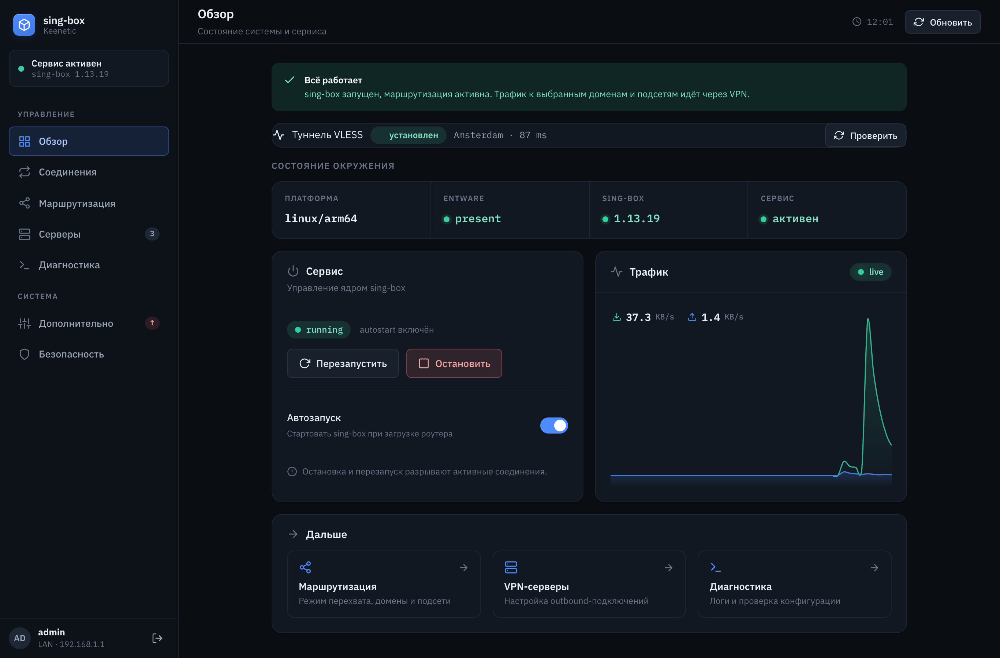
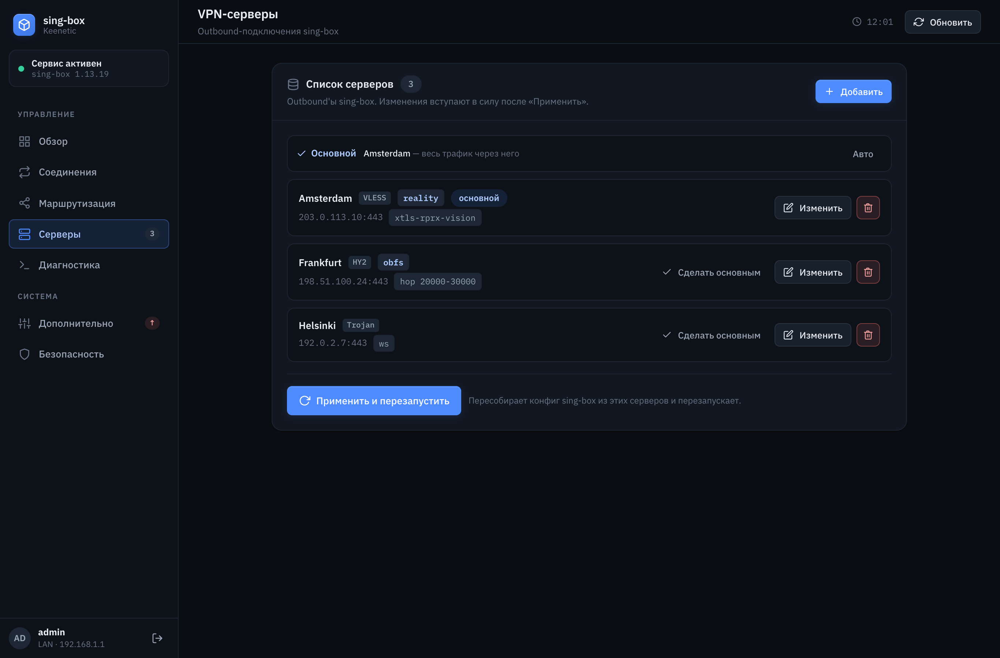
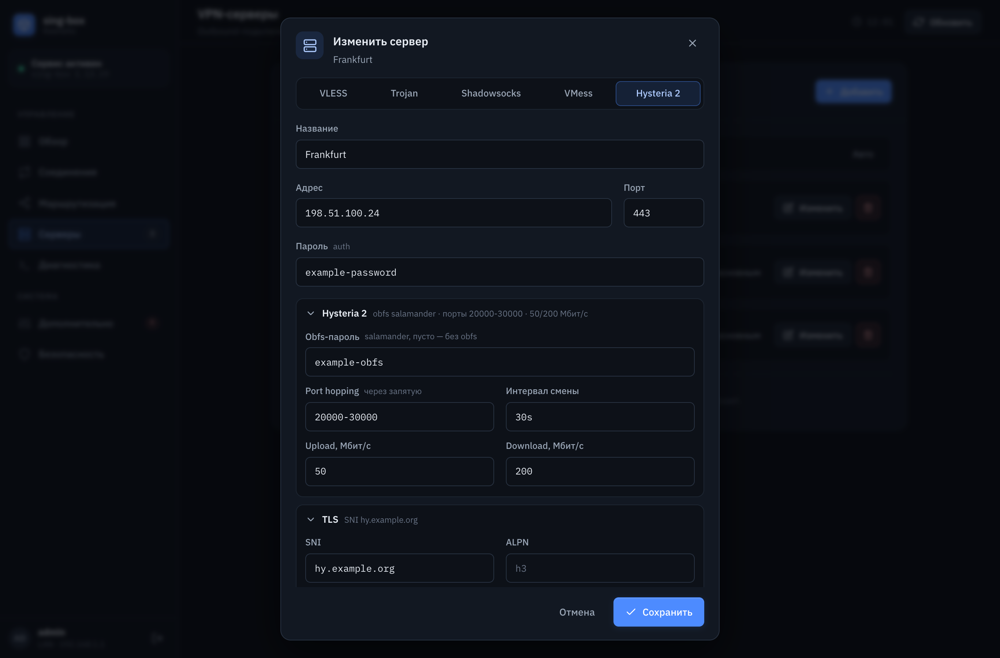
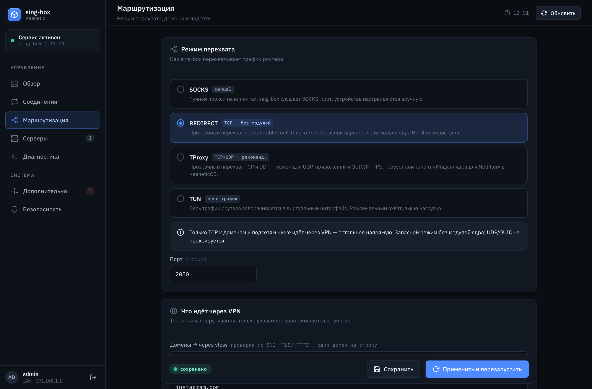
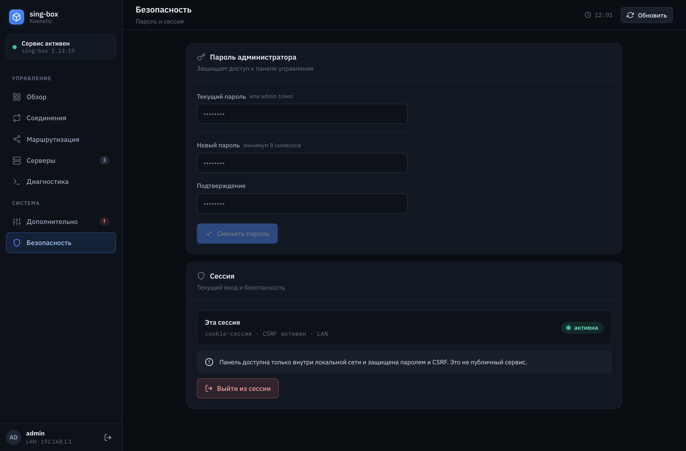

# keenetic-sing-box-ui

[](https://github.com/CoOre/keenetic-sing-box-ui/actions/workflows/ci.yml)
[](https://github.com/CoOre/keenetic-sing-box-ui/releases)
[](LICENSE)


Веб-интерфейс для управления [sing-box](https://github.com/SagerNet/sing-box) на
роутерах **Keenetic** (Entware, архитектура aarch64). Один статически
слинкованный Go-бинарник со встроенным фронтендом (Svelte) — без внешних
зависимостей на роутере.

> **Отказ от ответственности.** Это исследовательский проект: он изучает, как
> устроены KeeneticOS, Entware и sing-box и как управлять ими на роутере. Он не
> предназначен для обхода блокировок и ограничений доступа к информации и не
> должен для этого использоваться. Вы сами отвечаете за то, как применяете это
> ПО, и за соблюдение законов своей страны и условий провайдера и сервисов.
> ПО распространяется «как есть», без каких-либо гарантий (см. [LICENSE](LICENSE)):
> авторы не отвечают за любой ущерб от его использования, в том числе за
> неработоспособность роутера, потерю настроек или данных.

Возможности:

- управление серверами/outbound'ами: VLESS (Reality), Trojan, Shadowsocks,
  VMess, Hysteria 2 (obfs salamander, port hopping), TUIC v5 и AnyTLS; импорт share-ссылок,
  выбор основного сервера или автовыбор самого быстрого, проверка конфига;
- цепочки серверов (multi-hop через `detour`): из 2–5 любых серверов, в том числе
  из подписок. Каждый следующий сервер подключается через предыдущий, выход идёт
  через последний. Цепочка выбирается как отдельный выход или основной сервер
  и не участвует в автовыборе. При обновлении подписки сервер остаётся «тем же»
  (цепочки и выбор основного сохраняются), если не сменился адрес и при этом
  совпадают ключи или имя. Если сервер удалён, сменил адрес или одновременно
  ключи и имя, цепочка помечается сломанной и не попадает в конфиг. Обновление
  или удаление подписки сообщает, какие цепочки и основной сервер оно сломало;
- сборка и применение конфигурации sing-box;
- прозрачный проксинг с селективной маршрутизацией по доменам и CIDR:
  **TProxy** (TCP+UDP — проксирует и UDP/QUIC, рекомендуется; требует системный
  компонент «Модули ядра для Netfilter», установщик ставит его сам) или **REDIRECT + ipset**
  (только TCP, запасной режим — работает без модулей ядра);
- установка/обновление самого sing-box;
- диагностика, логи, управление сервисом, парольная аутентификация и HTTPS.

> ⚠️ Прозрачный проксинг изменяет правила firewall роутера (iptables/ipset).
> Используйте на свой риск и держите доступ к веб-админке Keenetic, чтобы
> откатить изменения при необходимости.

## Скриншоты

| Обзор | Серверы | Сервер Hysteria 2 |
| --- | --- | --- |
| [](docs/screenshots/02-overview.png) | [](docs/screenshots/01-servers.png) | [](docs/screenshots/05-server-editor.png) |

| Маршрутизация | Безопасность | |
| --- | --- | --- |
| [](docs/screenshots/03-routing.png) | [](docs/screenshots/04-security.png) | |

Данные на скриншотах вымышленные (адреса из TEST-NET, домены example.*).

## Архитектура

| Путь            | Что это                                                        |
| --------------- | ------------------------------------------------------------- |
| `cmd/`          | точка входа (`main`, подкоманды `token`, `firewall`)          |
| `internal/`     | бизнес-логика: config, servers, singbox, transparent, auth, … |
| `web/`          | фронтенд на Svelte + Vite, собирается в `web/dist`            |
| `web/embed.go`  | встраивает `web/dist` в бинарник через `go:embed`             |
| `packaging/`    | init-скрипты Entware (`S99…`) и хук установщика (`installer/`) |
| `scripts/`      | `install.sh` — установка, `mkinstaller` — сборка архива,      |
|                 | `install-router.sh` — dev-деплой по SFTP                       |

## Сборка

Требуется **Go ≥ 1.25** и **Node ≥ 22** (для сборки фронтенда).

```bash
make build          # фронтенд + бинарник под текущую платформу → dist/
make build-arm64    # кросс-сборка под роутер (linux/arm64) → dist/
make test           # go test ./...
make run            # локальный запуск на 127.0.0.1:9091
```

`make build` сначала собирает фронтенд (`npm install && npm run build` в `web/`),
затем компилирует Go-бинарник со встроенными ассетами.

## Установка

Нужен роутер Keenetic или Netcraze на **aarch64** с доступом в интернет.
Заранее ставить Entware, включать SSH или подключаться к роутеру по SSH не
нужно: всё делает сама прошивка. Желателен USB-накопитель с **ext4**; без него
установка идёт во внутреннюю память роутера, если она есть (её мало — см.
ниже).

### Проверено — работает

- Keenetic Giga (KN-1012)
- Netcraze Hopper DSL (NC-3611)

### Одной командой с компьютера

```bash
curl -fsSL https://raw.githubusercontent.com/CoOre/keenetic-sing-box-ui/main/scripts/install.sh | sh
```

Скрипт спросит адрес роутера (по умолчанию шлюз вашей сети), логин и пароль
администратора и работает только через HTTP-API роутера, так что кроме `curl`
ничего не нужно (macOS, Linux, WSL). Он:

1. ставит компоненты прошивки **OPKG** и **«Модули ядра для Netfilter»** (для
   режима TProxy), если их нет; роутер один раз перезагрузится;
2. показывает, куда можно поставить: USB-разделы и внутреннюю память,
   свободное место на каждом и где Entware (с UI) уже стоит, — и предлагает
   подходящий вариант: диск OPKG, иначе диск с Entware, иначе самый свободный
   USB-раздел с ext4, иначе внутреннюю память. Разделы не с ext4 и диски, где не
   хватит места, помечены. Если подключить накопитель, пока скрипт ждёт ответа,
   он об этом скажет — `r` обновляет список;
3. отдаёт прошивке ссылку на установочный архив и показывает ход установки из
   системного журнала роутера.

Через 1–2 минуты интерфейс открывается на `http://<роутер>:9091/`; при первом
входе задайте пароль.

Параметры: `--host`, `--user`, `--password`, `--disk storage:/|<uuid>:/`,
`-y` (без вопросов). Если роутер сам не достаёт до GitHub, `--relay` скачает
архив на компьютер и раздаст его роутеру по локальной сети (нужен `python3`).
Полный список — `sh scripts/install.sh --help`.

### Вручную, из веб-интерфейса роутера

То же самое без компьютера:

1. *Общие настройки → Изменить набор компонентов*: включите **«Поддержка
   открытых пакетов» (OPKG)** и **«Модули ядра для Netfilter»**, установите их,
   роутер перезагрузится.
2. Откройте командную строку роутера (`http://<роутер>/a`) и выполните:

   ```
   opkg disk storage:/ https://raw.githubusercontent.com/CoOre/keenetic-sing-box-ui/installer/keenetic-sing-box-ui-installer-aarch64.tar.gz
   system configuration save
   ```

   `storage:/` — внутренняя память; для USB-накопителя укажите его UUID или
   метку: `opkg disk <UUID>:/ …` (видно в `show media`). Если диск для OPKG уже
   был выбран, сначала выполните `no opkg disk`.
3. Ход установки виден в *Диагностика → Системный журнал* (записи
   `installer` и `keenetic-sing-box-ui`). Когда появится «Готово», откройте
   `http://<роутер>:9091/`.

### Как это устроено

Команда `opkg disk <диск> <URL>` — штатный механизм KeeneticOS: прошивка сама
скачивает архив, распаковывает его в `/opt` и запускает скрипты из
`/opt/etc/init.d`. Установочный архив (`make installer`, собирает
`scripts/mkinstaller`) — это официальный установщик Entware плюс
keenetic-sing-box-ui и одноразовый хук `S00keenetic-sing-box-ui-setup`. Сначала
Entware ставит себя, затем хук (`packaging/installer/setup.sh`) ставит
`iptables`, `ipset`, `ip-full`, кладёт бинарник и init-скрипт
`S99keenetic-sing-box-ui` и запускает сервис. Если загрузка пакетов Entware
обрывается, установка повторяется. Лог — `/opt/var/log/keenetic-sing-box-ui-install.log`.

На диск, где Entware уже стоит, тот же архив ставится поверх: настройки UI и
пакеты сохраняются, `opkg.conf` и SSH-ключи не перезаписываются. Это работает
со стандартным Entware, где initrc — `rc.unslung`.

Прошивка капризна к источнику: ссылка должна заканчиваться на `.tar.gz` и
отдаваться без редиректов с `Content-Type: application/octet-stream`.
GitHub Releases (302) не подходит, поэтому CI кладёт архив ещё и в ветку
`installer`, откуда его отдаёт raw.githubusercontent.com.

> ⚠️ Entware открывает SSH (dropbear) для `root` с паролем `keenetic`.
> Смените пароль (`passwd`) или отключите dropbear.

> ⚠️ Внутренней памяти у роутеров около 100 МБ. Entware, UI и sing-box
> (≥ 1.14 весит ~76 МБ) благодаря сжатию UBIFS занимают в ней около 42 МБ, и
> на обновление sing-box места хватает, но впритык, а запись логов изнашивает
> флеш. Если есть USB-накопитель с ext4, ставьте на него.

Обновления ставятся из интерфейса (*Дополнительно → Обновления*). Повторный запуск
установки переустанавливает UI поверх с сохранением настроек.

### Режимы прозрачного проксинга

Рекомендуемый режим — **TProxy**: он заворачивает и TCP, и **UDP** (нужно для
UDP-приложений и QUIC/HTTP3). Ему нужны модули ядра `xt_TPROXY` и `xt_socket`
из компонента «Модули ядра для Netfilter» — установщик ставит его сам; модули
подгружаются автоматически. Выберите режим на странице *Маршрутизация* и
нажмите *Применить*.

Если компонент недоступен на вашей модели или прошивке, используйте режим
**REDIRECT**: он работает без модулей ядра, но проксирует только TCP (UDP/QUIC к
выбранным хостам пойдёт напрямую).

### Для разработки

```bash
make install          # собрать архив и поставить его через scripts/install.sh;
                      # архив раздаётся роутеру с этой машины (нужен python3)
make install-router   # быстрый деплой dev-сборки по SFTP на роутер, где уже
                      # настроены Entware и SSH (см. шапку scripts/install-router.sh)
```

`install-router.sh` берёт адрес, логин и пароль из флагов, переменных
окружения или `.env` (`cp .env.example .env`) и требует `sshpass`, `ssh`,
`sftp`. С `--from-release` / `--release-tag TAG` он заливает готовый бинарник
из GitHub Releases вместо сборки.

## Релизы и CI

GitHub Actions (`.github/workflows/ci.yml`) на каждый push гоняет `go vet`,
`go test`, `golangci-lint` и кросс-сборку. По тегу `v*` собирается
`make package` и публикуется релиз с `.tar.gz` под aarch64, установочным архивом
(`keenetic-sing-box-ui-installer-aarch64.tar.gz`) и `sha256sums.txt`; установочный
архив также force-push'ится одним коммитом в ветку `installer`.
Текст релиза собирается из коммитов с прошлого тега
(`scripts/changelog.sh notes <tag>`) по разделам Conventional Commits:
«Новое» (`feat`), «Исправления» (`fix`), «Производительность», «Рефакторинг»,
«Прочее»; `!`/`BREAKING CHANGE` — в «Несовместимые изменения».

```bash
make release V=v0.1.7           # CHANGELOG.md + коммит chore(release) + тег
git push origin main v0.1.7     # CI соберёт и опубликует релиз
```

`make changelog [NEXT=v0.1.7]` только перегенерирует `CHANGELOG.md`.

## Лицензия

[MIT](LICENSE)
